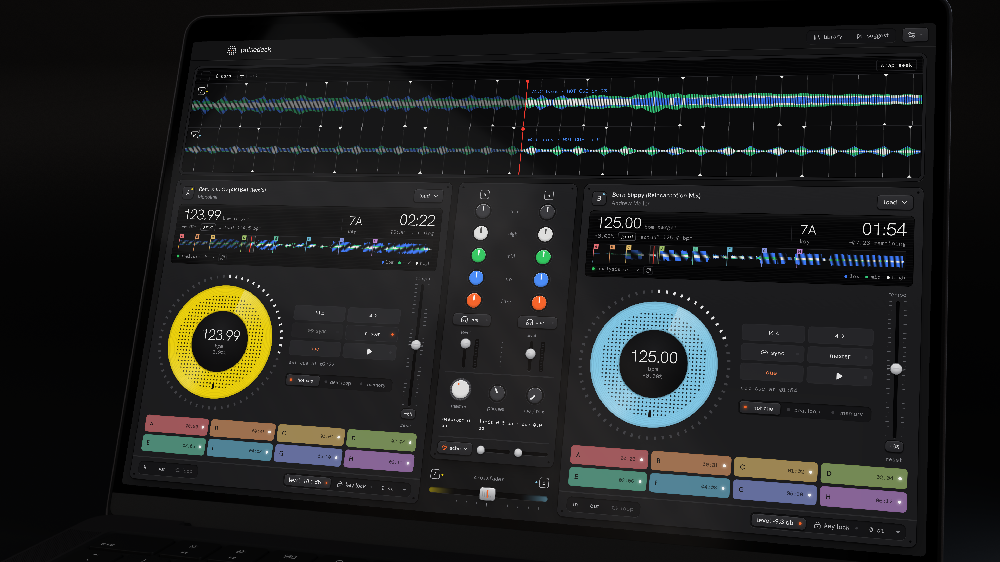
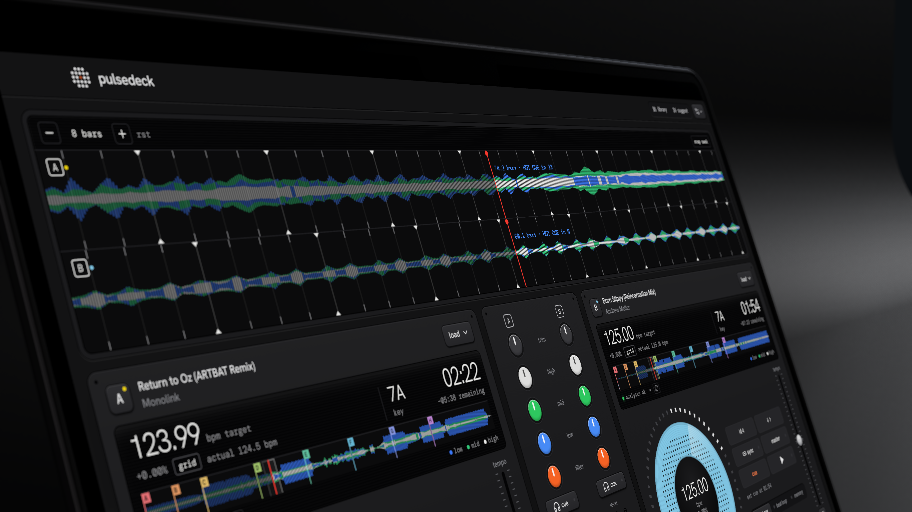
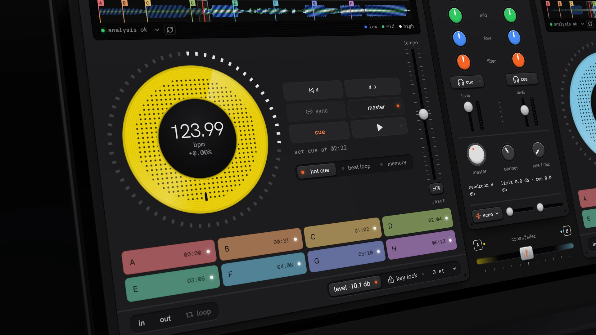
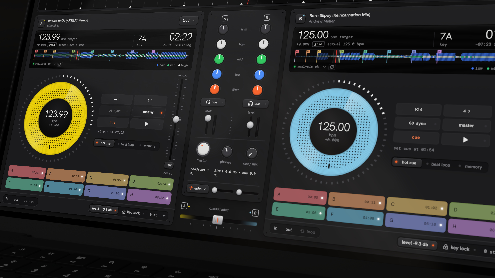
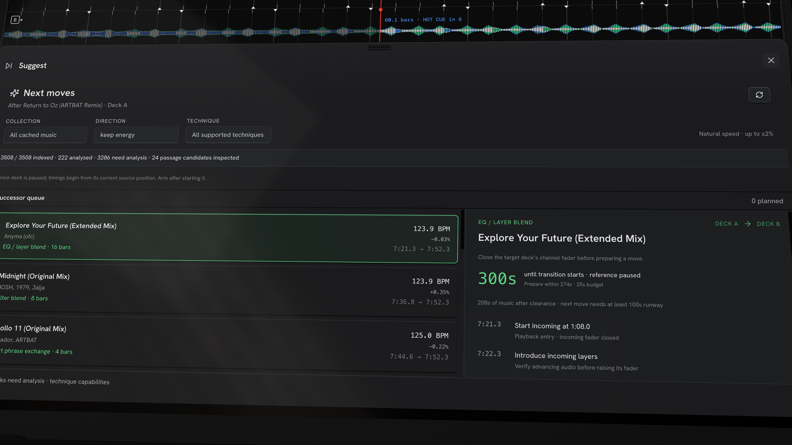
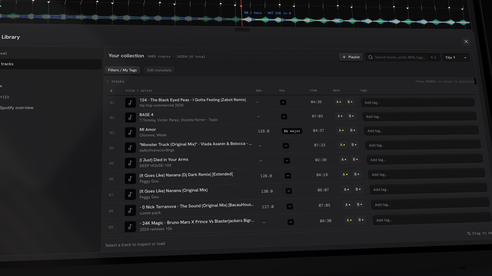
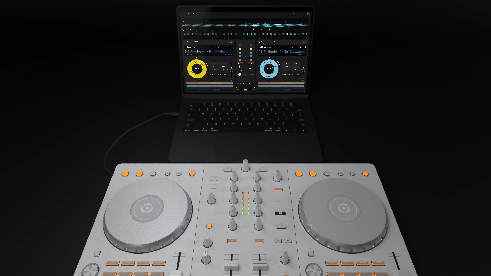

# PulseDeck

**Your music. One instrument.**

A native, two-deck DJ app for macOS. Mix local music and Spotify, shape your sound, and plan your next move—or let your agent help with the music and the preparation.

[**Download for macOS**](https://github.com/bhaiG-de/pulsedeck/releases/latest) · [Features](#features) · [Install](#how-to-install) · [Library](#library-setup-and-support) · [Controllers](#controller-support) · [Agents](#agent-workflows)

[](docs/images/01-hero.webp)

## Features

### See the music ahead

Stacked, three-band waveforms bring both tracks onto one timeline, with beatgrids, playheads and cue markers to help you line up the next transition.

[](docs/images/02-waveforms.webp)

### Play and shape the mix

<table>
  <tr>
    <td width="50%"><a href="docs/images/03-deck.webp"></a></td>
    <td width="50%"><a href="docs/images/04-mixer.webp"></a></td>
  </tr>
  <tr>
    <td><strong>Find your entry.</strong><br />Jog, cue, loop, beat jump and Sync.</td>
    <td><strong>Shape the overlap.</strong><br />EQ, filters, echo, reverb and faders.</td>
  </tr>
</table>

- **Two native decks:** tempo control, key lock, pitch shifting, hot cues, memory cues and editable beatgrids.
- **Audio control:** loudness normalization, output limiting and separate master/headphone routing. Echo and reverb tails continue after the outgoing fader closes.
- **Recording:** capture eligible local mixes as WAV. Spotify playback and its remaining effect tails cannot be recorded.

### Know what comes next

Click **Suggest** in the top bar for ranked next-track options, transition techniques and timing based on the current decks. Compare EQ blends, filter blends, short exchanges, echo outs and reverb exits.

[](docs/images/06-suggest.webp)

Use the **Successor queue** to run an ordered set or a collection with tempo, energy, technique and duration limits. The native engine prepares tracks and times transitions; manual takeover yields control to you. It asks for attention when no feasible continuation is available. Suggestions depend on usable analysis and available audio; musical judgment still matters.

## How to install

### Download the ready-to-run app

Requires **Apple Silicon and macOS 12 or newer**.

1. Download **PulseDeck_0.2.2_aarch64.zip** from [the latest release](https://github.com/bhaiG-de/pulsedeck/releases/latest).
2. Double-click the ZIP to extract **PulseDeck.app**, then move it to **Applications** and open it. No installer or build tools are needed; the audio engine, analysis models, control CLI and DJ skills are bundled.
3. If macOS blocks the first launch, dismiss the warning, open **System Settings → Privacy & Security**, scroll to **Security**, choose **Open Anyway** for **PulseDeck.app**, and confirm **Open**. This download is not Apple-notarized, so the ZIP still requires approval.

Opening PulseDeck again brings the existing window forward, including when it is hidden or minimised. A clean ZIP install with a fresh profile, repeat launches, hidden/minimised window recovery and quit/restart was verified on Apple Silicon with macOS 26.7.1 on 20 October 2026; repeat launches kept one process running with no new crash reports. Other macOS versions have not been checked in this installation test.

On macOS 12, first-launch approval is in **System Preferences → Security & Privacy → General**. Approve only a download you trust from the official release. See [Apple’s instructions](https://support.apple.com/en-us/102445). Releases include `SHA256SUMS.txt` for download verification. For Codex or Claude Code setup, see [Agent workflows](#agent-workflows).

### Run from source

Install Xcode command-line tools, Node.js 22.6+, Python 3 and stable Rust, then run from the repository root:

```sh
npm ci
npm --prefix frontend ci
python3 tools/ensure-beat-models.py
bash tools/rust-env.sh npm run desktop
```

For agent control of a development build, also run `bash tools/rust-env.sh cargo build -p pulsedeck-cli`. See the [development guide](docs/DEVELOPMENT.md) for packaging, tests, release automation and architecture.

## Library setup and support

### Local music

Choose **Import folder…** to add your music, then open **Library** to search tracks, browse playlists and manage tags. Imports read file metadata; missing beat, key and waveform analysis completes when a track is loaded. Saved analysis is reused, and manual/imported cues are preserved.

[](docs/images/05-library.webp)

Build local playlists, edit tags and cues, or exchange library metadata through **rekordbox XML**. Tracks decode into RAM, so large files and concurrent analysis need memory headroom.

### Spotify

1. Open **Settings → Spotify** and follow the developer-app setup shown there. Save your public Client ID and register the displayed redirect URI.
2. Choose **Sign in with Spotify** for Liked Songs, playlists and Connect access.
3. For deck playback, choose **Sign in to control player** and authorize the same **Premium** account separately.

Library access and deck playback are separate sign-ins. Connect plays on a Spotify device; it does not load a PulseDeck deck. Liked Songs and playlists support full pagination/indexing, while audio analysis is a separate step.

**Spotify deck playback is experimental** and depends on provider availability and account eligibility. Playback audio is held in bounded memory, not saved as an audio library cache. Credentials stay in macOS Keychain/app-private configuration.

For connection, audio or analysis issues, use the [setup and recovery guide](.agents/skills/pulsedeck-control/references/setup-and-recovery.md). Please include the app version and error message in [an issue](https://github.com/bhaiG-de/pulsedeck/issues), with credentials and private paths removed.

## Controller support

**Pioneer DJ DDJ-FLX4** is the current controller profile, covering deck transport, jogs, tempo, EQ, faders, browsing, cues and supported LED feedback.

[](docs/images/07-controller.webp)

Connect by USB, open **Settings → Controller**, refresh MIDI ports, select the FLX4 input and optional output for LEDs, then choose **Connect controller**. Audio routing is configured separately in Audio settings; discrete headphone monitoring needs a separate output pair.

The integration is independently implemented. Physical controls, LEDs and routing still need further hardware validation; this is not a claim of Pioneer certification or universal MIDI-controller support. See the [FLX4 adapter notes](crates/flx4-midi/README.md).

## Agent workflows

Use **Codex or Claude Code** to work with PulseDeck through three bundled skills:

| Skill | What it handles |
|---|---|
| **pulsedeck-library** | Finding music, playlists, tags, analysis, saved cues, beatgrids and rekordbox XML |
| **djing-art** | Track selection, set order, energy, harmony and musical transition planning |
| **pulsedeck-control** | Deck preparation, playback, transitions, continuous sets, routing and recording |

### Connect your agent

1. On first launch, choose **Codex**, **Claude Code**, or both in the welcome screen and click **Install skills**. You can also use **Settings → Agent skills** anytime. Existing PulseDeck skill packages are backed up outside the agent’s skills folder before updates; unrelated skills stay in place.
2. Restart the selected agent to discover the skills. Keep PulseDeck open and set up your local library or Spotify account.
3. Ask the agent to **use the PulseDeck skills**, then describe the workflow you want. No separate MCP server is required; the app includes its CLI.

Setup installs into `~/.codex/skills/` or `~/.claude/skills/`, respecting `CODEX_HOME` and `CLAUDE_CONFIG_DIR` when configured. For manual installation, copy the three folders from `/Applications/PulseDeck.app/Contents/Resources/dj-skills/` into the agent’s skills folder, first backing up older PulseDeck skills outside that folder.

For a source checkout, install the skills with `python3 tools/install-dj-skills.py --destination PATH_TO_AGENT_SKILLS` into a destination without existing PulseDeck skill folders. See [skill installation](.agents/skills/README.md#discovery-and-installation).

### Things to ask

| Workflow | Example prompt |
|---|---|
| Explore | “Use the PulseDeck skills to find local tracks between 120 and 126 BPM with my warm-up tag.” |
| Tag music | “Add the tag ‘warm-up’ to these selected local tracks. Keep their existing tags.” |
| Prepare cues | “Set a hot cue named ‘Mix in’ at 00:32 on [track]. Preserve its other cues and leave playback unchanged.” |
| Prepare a set | “Plan a one-hour progressive house set from my local playlist. Show the order and transition ideas without starting playback.” |
| Maintain the library | “Check these tracks for missing analysis, update it, and preserve my saved cues and beatgrids.” |
| Play a mix | “DJ a smooth one-hour mix from my Spotify Liked Songs. Choose the phrases and techniques yourself.” |
| Record | “Record a 30-minute mix from this local playlist and save the WAV.” |

You can invoke `$pulsedeck-library`, `$djing-art` or `$pulsedeck-control` in Codex, and `/pulsedeck-library`, `/djing-art` or `/pulsedeck-control` in Claude Code.

An agent can DJ successive moves and direct controls itself or choose the optional app-owned successor queue. With the queue, PulseDeck chooses subsequent transitions; `--wait-ready` verifies the first armed successor before an optional handoff. Collection queues prepare unanalysed candidates as needed; indexing alone does not establish mix readiness. Tags and cue edits use explicit instructions; automatic cue generation and verified vocal/phrase classification are not built in.

[CLI examples and execution details](docs/CLI.md) · [Skill reference](.agents/skills/README.md) · [Known limits](docs/DEVELOPMENT.md#current-limits) · [Image notes](docs/images/README.md) · [Licenses](NOTICE.md)
