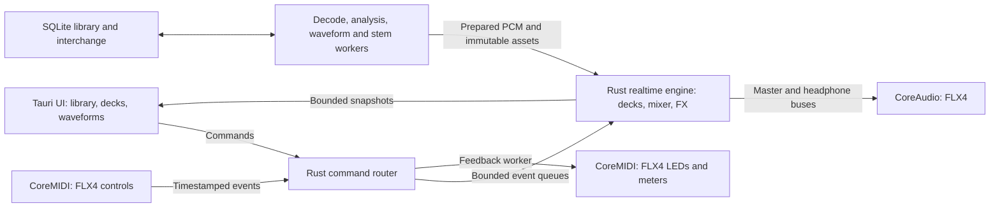

# Rust and Tauri architecture for DDJ-FLX4 performance

This document records the original research/design proposal. PulseDeck now implements a first native Rust/Tauri build; see [current implementation status](implementation-status.md). Historical research-pass limitations below do not describe the current source tree.

The proposed design puts playback, mixing, timing and controller handling in native Rust, with Tauri presenting the library and decks. Matching rekordbox requires measured audio behavior and a feature acceptance matrix. Rewriting in Rust alone does not establish equivalent latency, sound quality or reliability.

The installed build is now located and inspected: **7.2.19.0342**, native C++/JUCE with a CoreAudio processing graph, CoreMIDI, SQLCipher, TensorFlow/ONNX and a separate Electron cloud helper. [Installed architecture findings](installed-rekordbox-architecture.md) distinguish actual observations from inferred roles and unknown algorithms. The architecture below is the independent Rust/Tauri design, not recovered original source. Local investigation status appears in [investigation-status.md](investigation-status.md).

## Native engine and interface

[Tauri's process model](https://v2.tauri.app/concept/process-model/) provides a Rust core and a separate webview interface; macOS uses WKWebView. Use that boundary for coarse commands and visual snapshots. Keep the audio callback independent of webview rendering, JavaScript timers and Tauri message delivery.

Suggested components and responsibilities:

| Component | Responsibility |
|---|---|
| `engine` | Sample-frame transport, two initial decks, cue/loop state, mixing, output buses, parameter smoothing and meters. Independent of Tauri. |
| `audio-macos` | CoreAudio device/stream enumeration, format negotiation, callback, timestamps, latency reporting, reconnect and routing. |
| `controller-flx4` | CoreMIDI input/output, official mapping, precise controls, touch/jog behavior, pad modes, feedback and connection lifecycle. |
| `decode` | File demux/decode, seek indexing and bounded PCM buffers, away from the callback. |
| `analysis` | Waveform pyramids, BPM/beat grids, key and optional stems; cancellable background jobs with CPU/memory budgets. |
| `library` | SQLite metadata, playlists, cue/grid revisions, history, missing-file relocation and XML migration. |
| `dsp` | EQ, filtering, resampling, scratch playback, time stretching, pitch/key processing and effects. Algorithms selected through listening and measurement. |
| `app` | Tauri commands, device settings, library queries and presentation snapshots. |
| `bench` | Offline render comparisons, event replay, timing distributions and sustained hardware tests. |

These are proposed module names, not generated crates or discovered rekordbox components. Start with an engine in the Rust core process. A dedicated engine process could later improve isolation from shell crashes, but introduces its own IPC and lifecycle work.

## Audio deadlines and timing

The audio callback owns authoritative transport and processes a bounded amount of work per invocation. Do not allocate/free arbitrary objects, acquire blocking locks, query SQLite, decode compressed files, perform network I/O or call Tauri from it. Prepare assets on workers and transfer ownership with a reclamation strategy that keeps destruction off the callback. Dezipper gain/filter changes, handle denormals and retain bounded overload behavior.

MIDI and UI are separate event producers. Give each a bounded queue, or serialize them outside the callback; a single-producer queue cannot accept multiple producers safely. Timestamp events in one host-clock domain and map them to sample frames using actual output timestamps and device latency. Define overflow explicitly: coalesce superseded continuous-control updates where possible; preserve jog deltas and transport releases, and expose overflow diagnostics.

Use a common sample-frame clock for beat phase, quantization, sync, loops and deck positions. Present snapshots at a bounded rate, initially 30–60 Hz, while the UI interpolates playhead movement. Waveform pyramids and viewport-sized slices avoid sending entire PCM or redrawing a full track at every frame. MIDI output and telemetry collection happen outside the render callback.

[Apple documents](https://developer.apple.com/documentation/audiotoolbox/understanding-audio-workgroups) that missed render deadlines interrupt playback. Framework-provided render threads automatically join the device workgroup; extra real-time rendering threads need the appropriate workgroup integration. Begin with one render callback before introducing parallel DSP.

At 48 kHz, 128 frames allow 2.67 ms per callback and 256 frames allow 5.33 ms. These are arithmetic block durations, not measured FLX4 end-to-end latency. Start hardware trials at a supported 256-frame configuration; attempt 128 only after stable stress results. Record accepted buffer size, input/output latency, safety offsets and DSP algorithm latency.

## FLX4 integration

The FLX4 uses the standard macOS audio driver, so there is no indicated need to write a kernel driver. Use CoreAudio for audio and CoreMIDI for MIDI input/output. [Official driver FAQ](https://support.alphatheta.com/en-us/articles/12410664372121).

The retained official MIDI table provides controls and feedback, including precision faders, loaded indicators, vinyl mode and meters. Preserve its paired MSB/LSB values and special message semantics. Exact USB channel order, endpoint identity, startup needs, LED timing and jog behavior must be tested on the connected device. [Official MIDI list](https://downloads.support.alphatheta.com/software_info/dj-controllers/DDJ-FLX4/DDJ-FLX4_MIDI_message_List_E1.pdf).

Provide independent master and headphone buses. Discover which device channels reach each physical output rather than assuming channel numbers. Treat simultaneous built-in-speaker output as a separate clock-domain problem requiring drift handling. Map microphone/recording streams from actual device observations.

Smart Fader and Smart CFX require application behavior beyond recognizing the button. Use the documented functions as an acceptance boundary; inspect reference interactions and recorded audio to derive tempo/EQ/effect transitions. Exact algorithms and preset recipes are not established by the public mapping. Details and table caveats are in [flx4-official-findings.md](flx4-official-findings.md).

Candidate libraries, pending a hardware spike: [CPAL](https://github.com/RustAudio/cpal) for audio I/O, a [CoreMIDI binding](https://github.com/chris-zen/coremidi) for timestamped device integration, and [Symphonia](https://github.com/pdeljanov/Symphonia) for decoding. Validate CPAL's multichannel routing, device timestamps, buffer control and disconnect behavior against the actual FLX4; a direct CoreAudio adapter may be needed. Do not choose a generic playback helper that hides independent deck transport or cue routing. Library support claims do not establish tested performance here.

## Feature parity and build order

The user confirmed local two-deck performance on FLX4 first, while preserving a full-product roadmap. The installed reference build is identified. The [implementation roadmap](implementation-roadmap.md) expands these stages into work packages and acceptance evidence.

| Stage | Deliverable | Acceptance evidence |
|---|---|---|
| 0 | App inventory, FLX4 enumeration and reference baseline | Build hashes, dependencies, verified stream routing, control/LED captures and benchmark fixtures. |
| 1 | Native playback/mixer with a small Tauri shell | Independent deck load/play/cue/seek, gain/EQ/crossfader, master/headphone buses, correct restart/reconnect behavior. |
| 2 | Complete FLX4 controller performance | Jog scratch/bend/search, tempo range, sync/master, loops, quantize/slip, hot cues, Beat Jump, pad modes and deterministic feedback. |
| 3 | Library and preparation | Metadata/search/playlists/history, waveforms, BPM/key/grids, manual grid correction, cue persistence, XML migration and missing files. |
| 4 | Sound and creative features | Key lock/stretching, sampler, Beat/Pad/Release FX, Smart modes and matching audio/control scenarios. |
| 5 | Wider rekordbox product scope | Stems, export/device libraries, network player workflows, DVS, video/lighting, streaming and cloud: each a separate subsystem and acceptance suite. |

Use the official [FLX4 rekordbox hardware diagram](https://downloads.support.alphatheta.com/software_info/dj-controllers/DDJ-FLX4/DDJ-FLX4_HardwareDiagram_rekordbox_E1.pdf) to enumerate controller actions and shifted controls. That covers the hardware's workflow, not every feature in the installed rekordbox product. Wider scope is derived from the version-matched manuals and enabled modes once identified.

Use [rekordbox's published XML interchange](https://rekordbox.com/en/support/developer/?lang=en) for initial migration. Test track paths, cue types, beat-grid data and round trips using exported fixtures. XML does not establish compatibility with private library databases, proprietary analysis files or USB player export formats. Inspect those separately when they enter scope. Partner services and third-party DSP/model integrations require independent implementation choices and access; their availability cannot be inferred from an app bundle.

Tauri normally means a Rust backend with a web interface. If the intent is Rust source for the interface too, a Rust/Wasm UI is an option, but the engine must still run natively. Select the UI stack after the engine/device spike.

## Proving comparable performance

Use the same Mac, FLX4, firmware, supported sample rate, hardware buffer, audio files and output routing in both apps. Record which modes and features are enabled. Include steady playback, scratching, rapid hot cues, loops/sync, tempo/key changes, effects, library browsing and background analysis. Baseline comparison requires that exact installed reference build.

| Dimension | Method |
|---|---|
| MIDI-to-audio response | Record controller event timestamps and capture physical output; report median/p95/p99 and the measurement/clock uncertainty. |
| Cue and loop accuracy | Offline impulse/transient fixtures plus physical capture; check seek decoder priming, loop seams, quantize and drift. |
| Render stability | Record callback duration distribution and deadline misses; stress disk, analysis, effects and UI independently and together. |
| Scratch and stretch quality | Compare rendered audio over tempo/pitch ranges and scripted jog trajectories; combine objective artifacts with listening. |
| UI latency | Trace input-to-visible update, waveform frame pacing and large-library queries while audio plays. |
| Resource use | Record CPU, resident memory, load/analysis time, battery behavior and thermal conditions. |
| Device lifecycle | Disconnect/reconnect, sleep/wake, sample-rate change, wrong device, lost MIDI endpoint and safe shutdown. |

Proposed early gates: zero detected dropouts during a 60-minute representative workload; p99 callback duration below half the negotiated block duration with maximum/deadline misses also reported; no callback allocations; correct independent cue/master output and all mapped controller actions. These are engineering goals, not results or claims about rekordbox. Long-tail tests must run beyond the early gate before live-performance use. End-to-end response should be judged against the measured reference, not guessed from buffer size.

No running Rust/Tauri application or comparable-performance result is delivered by this research pass. Bundle inspection is complete at the metadata/component level, with sampled audio paths and focused Smart-feature branches. The next decisive step for hardware parity is successful FLX4 OS enumeration, then reference audio/MIDI measurements and an independently implemented native engine.
