# Installed rekordbox architecture and Rust migration

The inspected build is **rekordbox 7.2.19.0342**, installed at `/Applications/rekordbox 7/rekordbox.app`. Its main application is a native C++/JUCE program with a CoreAudio processor graph and CoreMIDI integration. An embedded Electron application supplies a separate cloud/library helper. A Rust/Tauri recreation should preserve the native audio boundary and move library, analysis and cloud workloads onto separate workers.

This pass establishes the main framework, important subsystem boundaries and concrete FLX4 mapping resources. It does not establish matching latency, exact time-stretch/FX algorithms, every enabled feature, or physical controller behavior. The user selected a full roadmap with two-deck DDJ-FLX4 performance first.

## What the installed artifacts establish

| Subsystem | Observed evidence | Rust/Tauri consequence |
|---|---|---|
| Main app | REA plist gives build 7.2.19.0342; Mach-O contains arm64 and x86_64 slices. Local C++ symbols and a live sample show `juce::JUCEApplicationBase::main`, JUCE components and `JUCE v8.0.8: Timer`. | A native Rust engine replaces C++/JUCE. Tauri replaces the presentation layer; it must not become the audio scheduler. |
| Audio device interface | Main imports `AudioDeviceCreateIOProcID`, `AudioDeviceStart`, AudioObject property queries and related CoreAudio APIs. The sampled callback runs through `rb::CoreAudioClasses::CoreAudioInternal`. | Use a native CoreAudio adapter, explicitly negotiating streams, buffer size, sample rate and latency. |
| Audio processing | Live callback sample reaches `FixedFsAudioProcessor<Float4>`, `AudioProcessorGraph`, `DjMixerUnit`, envelope/filter and effect nodes. | Construct an explicit processing graph for decks, mixer, cue bus and FX, with no UI work in rendering. |
| Time/pitch and audio paging | Sampled threads include `PitchTimeStretchFGPR`, `TimeStretchFGPR`, `PagingAudioSource` and `AudioSourceDeleter`. Local symbols include `TimeStretchManager::operate`, speed/mode changes and discontinuity parameters. | Put expensive preparation and resource reclamation off the callback. Implement seeking/scratching/loop discontinuities as first-class engine events. Exact DSP remains to be established. |
| Analysis | Main links TensorFlow 2.16.1 and ONNX Runtime 1.18.0. Resources include TensorFlow `detect_beat/model7` and `model8`, ONNX cue prediction/sample-CNN, energy/genre/embedding and UMAP assets. | Analysis is broader than stems. Give analysis its own cancellable job service and cache; an equivalent independent model pipeline needs separate quality validation. |
| Stem candidates | Inventory includes `libSpleeter.dylib` and `libDemucs3.dylib`. | These names identify shipped components, not the currently selected separator, loaded model, runtime quality or a right to reuse packaged weights. Investigate and choose an independent implementation. |
| Decode | Main imports mpg123 functions and loads `libmpg123.0.dylib`; platform AVFoundation/AudioToolbox are linked. | Build a format-aware decoder service with precise seeking. Static linkage does not establish the decoder used for every format. |
| Persistence | Main loads `libsqlcipher.0.dylib` and imports SQLite APIs including `sqlite3_key`. Helper includes SQLCipher native bindings and Sequelize. | Database encryption capability and ORM components exist. Exact private database format is unresolved; use published XML migration first and an independently designed local schema. |
| Controller support | CoreMIDI imports plus a shipped FLX4 profile of 201 active rows; native `DeviceDefs` and controller/Smart classes are present. | Implement a typed, mode-aware controller adapter and feedback scheduler. Cross-check public protocol, shipped profile and actual device traffic. |
| Rendering | Main imports Metal/MetalKit and contains `default.metallib`; live sample reaches Metal display/render threads. | Efficient waveform rendering matters independently of audio deadlines. Use cached waveform levels and bounded UI snapshots, then benchmark the webview. |
| Cloud helper | `rekordboxAgent` 3.3.0 embeds Electron 19.0.10, architecture-specific Bytenode `.jsc` logic, and a small React notification renderer. | Replace with Rust background library/sync jobs and Tauri events after local performance reliability. See the helper report for partial coverage. |
| Wider product | Sample includes Link/ProDJLink threads; native symbols include DVS controls; resources enumerate additional pad modes. | Keep link networking, export, DVS, expanded modes and other ecosystems as separate milestones with their own evidence. Names alone do not prove all available behaviors. |

Library versions in this table are the installed dependency filenames and parsed metadata; they are not guarantees about ABI compatibility or active execution. SQLCipher's presence does not establish that every database is encrypted or reveal a schema/key. Model paths suggest intended tasks without proving which model was used in this observation.

## Observed audio path

The one-second live stack sample at 15:52 IST observed this nested call chain on `com.apple.audio.IOThread.client`:

```mermaid
flowchart LR
  Core["CoreAudio IO thread"] --> IO["rb CoreAudioInternal: audioIOProc / audioCallback"]
  IO --> Limit["CallbackMaxSizeEnforcer"]
  Limit --> Manager["rb AudioDeviceManager"]
  Manager --> Player["JUCE AudioProcessorPlayer"]
  Player --> FS["FixedFsAudioProcessor Float4"]
  FS --> Graph["rb AudioProcessorGraph"]
  Graph --> Mixer["DjMixerUnit and nested graph"]
  Mixer --> Effects["Envelope / IIR / FX nodes observed"]
```

This is a sampled path, not a complete graph or an analysis of a loaded song. Sampling can perturb execution and misses paths outside its short window. `Float4` and fixed-rate wrapper names do not establish the actual engine rate, four physical output channels or a particular SIMD policy. Exact conversion algorithms, topology, latencies and active node settings remain unresolved.

Observed supporting threads included time-stretch workers, audio analysis, paged audio, audio-source deletion, waveform deletion, recording, network services and Metal display work. Separating resource destruction from audio is therefore supported by both the runtime observation and the proposed realtime design. Thread names do not by themselves establish worker budgets or lock-free behavior.

## Smart feature code is in the host

Focused ARM64 disassembly of five exact local symbols provides evidence beyond labels:

- `SmartFader::setSmartFaderEnabled` directly calls fader-curve update, master selection and `DjEngineIF::isSync`/`setSync`.
- `SmartFader::updateFaderCurve` directly queries mixer control and recommended/current fader-curve settings.
- `SmartFader::update` directly calls `getBpm` for the two deck selectors, `getMaster`, and `setTempo`.
- `SmartCFX::setSmartCfxEnabled` directly calls Touch FX restriction checks and notification/callback functions.

These establish compiled host-side orchestration. They do not recover the entire Smart Fader EQ/echo graph, preset DSP, exact firmware division or runtime outcomes. Only named direct branches were summarized; indirect and transitive calls remain outside that scope. Addresses and full bounded disassembly are preserved in `evidence/smart-feature-direct-call-summary.json` and its linked `.asm` files. This is shell analysis, not REA decompiler Evidence.

For the independent engine, model Smart Fader as a stateful feature involving sync ownership, tempo range, fader assignment, transition curves and effect automation. Treat Smart CFX as preset/state orchestration plus DSP. Keep both separate from raw MIDI decoding, and validate enable/disable restoration and conflicts against reference behavior.

## Controller evidence and physical-device blocker

The installed `Contents/Resources/MidiMappings/DDJ-FLX4.midi.csv` contains control, pad, indicator and settings declarations. It extends the public sheet with backspin, fader-start, cut-lag, mono/stereo and limiter candidates. The file does not supply all data-byte enums, startup ordering or firmware behavior. Shifted tempo and an FX-depth channel inconsistency require recorded hardware input. [Detailed controller report](rekordbox-controller-resources.md).

After the user confirmed connection and the PC/Mac port, the native property probe still returned **two built-in audio devices and zero CoreMIDI sources/destinations**. The IOUSB tree reported host controllers without an FLX4 child. This is an OS-enumeration observation, not evidence that the controller needs a vendor driver or that its hardware is defective. The official class-compliant requirement remains applicable.

Physical output routing, buffer limits, channel formats, initialization and MIDI-to-audio response remain pending until macOS recognizes the device. The read-only `tools/probe_macos_audio_midi.swift` is ready to rerun. No audio stream was started, no MIDI command sent and no controller setting changed by this investigation.

A concrete next check is the Mac's accessory approval prompt. [Apple documents](https://support.apple.com/en-gb/102282) that a USB accessory can receive power while its data connection remains unapproved on an Apple-silicon laptop. Reconnect with the Mac unlocked and approve this controller if prompted. This is a possible explanation, not an observed cause; broad accessory settings were neither changed nor recommended.

The native window inspected during this pass was the Introduction screen showing an ended-trial notice. No account, subscription or onboarding action was taken. The captured process sample is not a performance-mode benchmark. A one-time memory sample reported 1.5 GB physical footprint, with a 2.3 GB peak; those values describe that process/session only and are not performance targets or representative workload comparisons.

## Evidence and confidence

| Evidence | Identity or file | Coverage |
|---|---|---|
| REA bundle plist | `ev_12b451406e1004bfaef99ec5f6c547a0dd4f36b3a983c2778e4cd6e2725bc650` | Exact declared build, bundle ID and minimum OS. |
| REA main Mach-O | `ev_0cb56fe857156135bf806b67c3ff43ac5eb91abe354136a7ecf74dc5d45d27ad` | Slice/dependency metadata; symbol collections explicitly nonexhaustive. |
| REA artifact inspection | `ev_0f9e0cb5b5da4c2f5f25581bd40c12da6b40448650fec8d9d09ca0e908d16e86` | Inventory plus bounded static hypotheses. |
| REA inventory substep | `ev_72038f3cc108669838b0efd22a835302e12f27a5e7aa7f24185b268659c0c534` | 10,266 nodes, 12,369 occurrences; symlinks/path identities retain limits. |
| REA Apple projection | `ev_a748b374a17f6de5ed42f7c3d9f8034ed65591b6a0c66e4e7f049f0d5ef5ea58` | Component coverage from complete inventory; bridge-candidate coverage partial. Path-based role inference. |
| REA dyld resolution | `ev_1fe924908681aa4b5dfc9b5769871e2deea0dc1c9c09cbb71bcb6efe7b4e680d` | 29 parsed images, 26 roots/slices. System shared-cache paths undetermined; loading/trust not proven. |
| REA signature metadata | `ev_584e0a2433cc07c0a773888f92fdb71cc8250b04d93a325abacf1793971290d9` | Reported AlphaTheta identity/signature metadata; not filesystem trust verification. |
| Local symbol/assembly observations | `evidence/rekordbox-native-symbol-seeds.json`, `evidence/smart-feature-direct-call-summary.json` | Selected ARM64 symbol declarations and direct branches; no full decompilation. |
| Live shell observation | `evidence/rekordbox-process-sample.txt` | One-second existing-process sample; UI/audio/worker paths observed in that interval. |
| Device property probes | `evidence/coreaudio-coremidi-connected.json`, `evidence/coreaudio-coremidi-recheck.json`, IOUSB text files | Read-only OS discovery; FLX4 not enumerated at capture time. |
| Helper inspection | [rekordbox-agent-findings.md](rekordbox-agent-findings.md) | Selected extracted tree; compiled bytecode opaque and renderer semantics partial. |

Complete REA output lives under `evidence/rekordbox-7-installed`. Main executable SHA-256: `07dcecbaf304f777e435539c83c7dcc02e41de1eaf2e0a75e8a9852e4411a244`. Main executable and plist hashes were unchanged during collection; this is not an atomic full-bundle/runtime snapshot.

## Build direction

Start with an independently authored Rust engine and native device adapter; deliver two decks, precise cue/loop transport, EQ/faders, distinct master/headphone buses, timestamped MIDI and feedback before Smart FX or cloud features. Build the small Tauri shell around engine snapshots. The [architecture plan](architecture-and-parity.md) defines thread/queue and benchmark contracts; the [implementation roadmap](implementation-roadmap.md) makes the user-selected ordering concrete.

Further algorithm-level analysis requires either an available native provider or additional focused static/runtime work. No Hopper, Ghidra or IDA provider is configured, and no Java runtime was found. The static and sampled evidence above is sufficient to ground an architecture, but not to claim DSP or performance equivalence.

Local captures are excluded from the public repository; evidence paths above refer to the investigator’s local workspace.
