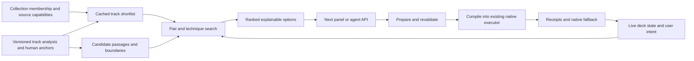

# Next track and transition planning for PulseDeck

Research and proposed architecture · 19 October 2026 · No runtime implementation in this document

PulseDeck should offer a ranked list of **track, passage, technique and timing options**. A person or agent chooses an option; PulseDeck prepares, validates and executes its musical timeline through the native audio engine. This moves repetitive signal analysis, beat arithmetic, preparation deadlines and command dependencies into the application while preserving the performer's choice of direction and technique.

The first implementation should support several useful techniques. A bass exchange is one recipe inside this system. It must not become the definition of a transition or impose equal tempos, a bass swap, or a sixteen-bar overlap on every pair.

## 1. What the live experiment established

The interrupted Luna performance exposed distinct problems:

| Observation | Architectural consequence |
|---|---|
| Initial selections came from the first 50 Liked Songs; read-only checks successfully paged beyond them in a collection of 1,489 tracks. | Collection coverage and analysis coverage must be visible. Ranking must operate on an indexed collection, rather than depend on which page a controller happened to inspect. |
| Lola's Theme reached EOF while Return to Oz remained paused with its channel closed. | The app must own readiness deadlines, a viable handover and recovery. “Next track loaded” cannot mean “ready to continue.” |
| A later launch was rejected as past; subsequent fader actions still ran while the incoming source was paused. | Compile dependent transition phases from a typed plan. A failed incoming launch must not authorize clearing healthy outgoing audio. |
| Recovery briefly started transport behind a zero fader. | Audible routing and advancing transport are separate postconditions. |
| Loading a source interrupted pending native work, including the original one-hour endpoint. | Source-bound transition ownership and session-wide endpoint ownership need separate lifetimes. |
| Source BPMs near 123 and 124 coexisted with a target near 119. One snapshot of Hindsight showed local BPM about 184.4 and actual rate about 0.764. | Distinguish native tempo, planned tempo, inherited offsets, local grid estimates and rendered rate. Reject unreliable overlap windows and enforce the selected technique's rate policy in execution. |

These observations establish performance failures. They do not establish that every failure is an engine defect. Rejecting a past launch is correct behavior; an unsafe plan around that rejection is a different problem. The grid/rate excursion needs a focused reproduction before its precise cause is declared fixed. Discrete observations cannot measure every gap's exact duration.

Luna and its owned queue/end timer were stopped at the user's request. This research does not continue the set.

## 2. What the reference products actually document

| Product | Documented behavior | Lesson for PulseDeck |
|---|---|---|
| **djay Automix** | Automatic or manual transition points; editable entry/exit regions; transition duration in bars or seconds; selectable effects and tempo policies. Its queue can use manual choices, matching songs or the current playlist. “Mix Now” finds an early suitable blend point. The manual describes the Automatic effect selection as random. | Show the proposed regions and let users edit them. Separate choosing a song, choosing a technique and choosing its timing. Do not confuse random technique variation with musical intelligence. [Using Automix](https://help.algoriddim.com/user-manual/djay-pro-mac/mixing-basics/using-automix), [Automix overview](https://help.algoriddim.com/user-manual/djay-pro-mac/mixing-basics/automix). |
| **djay Track Match** | Recommends tracks based on key and tempo, across the library and connected services; users can influence the reference selection. | A compatibility shortlist is useful independently of automatic performance. [Track Match](https://help.algoriddim.com/user-manual/djay-pro-mac/mixing-basics/match). |
| **Apple Music AutoMix** | Apple describes audio-feature analysis, time stretching and beat matching. Support documentation distinguishes dynamic AutoMix from a fixed-duration crossfade and lists incompatible genres/tempos, sequential album playback and some non-subscription content among situations where dynamic mixing may not occur. | Use content-dependent transition selection and permit abstention. Preserve an intentional album sequence. [Apple announcement](https://www.apple.com/newsroom/2025/06/apple-services-deliver-powerful-features-and-intelligent-updates-to-users-this-fall/), [AutoMix support](https://support.apple.com/en-us/105067). |

These are behavioral references. Their public documentation does not provide a reproducible internal ranking model, training set or transition optimizer. The architecture below is a proposal informed by published research and PulseDeck's code, rather than a claim about either product's private implementation.

## 3. Research findings that change the design

### Track compatibility and transition suitability are separate

Zehren, Alunno and Bientinesi distinguish compatibility between passages from the suitability of a point within a song. Their EDM switch-point method combines novelty, periodic structure and the prominence of the following material. Its reported roughly 96% usable candidates comes from a restricted expert evaluation on 134 tracks, principally around intro/core switch-in regions; it is not a 96% success rate for complete mixes. The useful design lesson is to generate several credible anchors with context, then evaluate a particular pair. [Automatic Detection of Cue Points for DJ Mixing](https://arxiv.org/html/2007.08411).

### Optimize passage pairs, not only whole-track metadata

Bittner and colleagues model playlist sequencing as graph traversal and transition placement as optimization over candidate regions. Their transition costs include timbre, chroma, loudness, vocal activity and structural alignment. Their listening test used 48 pairs constrained to at most five BPM difference. This supports a constrained, content-aware search; it does not establish a universal safe BPM gap or the best weights for this user's music. [Automatic Playlist Sequencing and Transitions](https://archives.ismir.net/ismir2017/paper/000086.pdf).

### Compute ahead of the deadline

Vande Veire and De Bie's Drum and Bass system separates offline annotation from live transition generation and buffers future work. It evaluates beat/downbeat/structure, style selection and vocal collision separately. Its genre-specific design and qualified listening setup matter: reported results should not be transferred directly to progressive house. The architectural lesson is bounded preparation with explicit runway, rather than waiting for an agent to finish reasoning near EOF. [From raw audio to a seamless mix](https://link.springer.com/article/10.1186/s13636-018-0134-8).

### Stems can expand options, but are not a prerequisite for the planner

Mosaikbox compares rhythm, timbre, harmonic content and spectral balance at phrase level, and uses rule-based stem modification for incompatible drums or vocals. Its experiment found a benefit from stem modification and did not establish a benefit from adding lyrics-derived contextual similarity. Its constant-grid assumptions and participant/music distribution limit transfer. Use its decomposition as a research reference; validate stems and representations against our material before adopting them. [Mosaikbox, ISMIR 2024](https://repositum.tuwien.at/handle/20.500.12708/212628), [author implementation](https://github.com/robaerd/mosaikbox).

### Beat accuracy and beat continuity both matter

Beat This! reports strong beat/downbeat F1 while acknowledging weaker continuity metrics and remaining failures. PulseDeck already uses a Beat This! model with its own DBN and acoustic evidence. Model activation scores cannot be treated as calibrated probabilities that a whole overlap is safe. Evaluate local continuity, metrical interpretation and the required playback-rate curve. [Beat This! paper](https://arxiv.org/html/2407.21658), [official implementation](https://github.com/CPJKU/beat_this).

### Functional structure needs appropriate training and evaluation data

All-In-One jointly models metrical and functional structure using demixed audio, offering a candidate advanced analyzer with a substantial source-separation dependency. It should be compared with a lighter boundary baseline, rather than immediately replacing the current rhythm pipeline. [All-In-One paper](https://arxiv.org/html/2307.16425), [official implementation](https://github.com/mir-aidj/all-in-one).

Raveform, published in April 2026, supplies metadata for 4,902 mixes, 56,873 unique tracks, 53,780 available transitions and expert structural annotations for 1,423 tracks. Its transition positions are estimated from alignments; those are distinct from the manually checked structural labels. Its EDM vocabulary, exclusions and cross-dataset tests make it especially relevant for evaluating an EDM planner, while also demonstrating that pop-derived structure labels should not be assumed to transfer unchanged. [Raveform](https://reference-global.com/article/10.5334/tismir.288?tab=article).

### Separate three time scales

Williams and colleagues distinguish transition-level control, next-track selection and mix-level direction. Their 2025 framework explains why a generic sequential recommender does not solve DJ transitions. This is a useful division of responsibilities: native execution owns the immediate clock; the planner owns candidate passages; a person or agent supplies longer-term direction. [Temporal Considerations in DJ Mix Information Retrieval and Generation](https://drops.dagstuhl.de/entities/document/10.4230/LIPIcs.TIME.2025.20).

### A more complicated model is not automatically a better first release

DJtransGAN learns EQ/fader trajectories, but its listening evaluation did not establish a significant overall advantage over both linear and rule-based baselines; cue/segment selection remained a limitation. Keep transparent recipes as the first control model. Later learning can improve ranking or curves against a strong baseline. [Differentiable DJ transitions](https://arxiv.org/html/2110.06525).

Recent work also explores embeddings and generated musical bridges. Generating replacement audio changes the product's relationship to the original recordings and adds another quality problem. It is a separate possible feature, rather than a dependency of a next-transition list. [DJ AI, Audio Mostly 2025](https://research.sabanciuniv.edu/id/eprint/52373/1/AI_DJ_AM2025.pdf).

## 4. Extend the existing application

| Existing component | Reuse | Missing capability |
|---|---|---|
| [suggest.rs](../src-tauri/src/suggest.rs) | Compact cached features, source scopes, history exclusions, tempo/key/energy shortlist. Current weights are 45/35/20 and default stretch is 3%. | Passage/technique-aware ranking, local content features, per-style constraints, plan generation. A whole-track score is not a transition score. |
| [NextPanel.tsx](../frontend/src/NextPanel.tsx) | Existing Next surface and controller navigation. | The current UI request passes energy direction; add explicit collection/style context, analysis coverage, timings, preview and option selection. |
| [library.rs](../src-tauri/src/library.rs), [spotify_analysis.rs](../src-tauri/src/spotify_analysis.rs) | Persistent membership, cached analyses, staged/bounded work; foreground deck loads already take priority over page analysis. | Collection-wide metadata indexing and visible analysis coverage as a deliberate workflow; bounded preparation of useful candidates. |
| [audio-analysis](../crates/audio-analysis/src/lib.rs), [cache.rs](../crates/audio-analysis/src/cache.rs) | Existing beat/key/waveform stages, content fingerprints and versioned dependencies. | Versioned local structure, tonal/rhythm and optional vocal features. |
| [BarEvidence](../crates/audio-analysis/src/dbn/bars.rs), [track_inspection.rs](../src-tauri/src/track_inspection.rs) | Acoustic recurrence/pulse-repair evidence and effective event timelines. | Phrase-scale boundaries and quality over each proposed overlap. Existing bar evidence is not a phrase label. |
| [cues.rs](../crates/audio-analysis/src/cues.rs) | Stable, human-owned manual/imported anchors and roles. | Separate derived proposals, with provenance and uncertainty. Do not fill hot cues or overwrite manual cues merely to show suggestions. |
| [scheduled.rs](../crates/deck-engine/src/scheduled.rs), [scheduled_runtime.rs](../crates/deck-engine/src/scheduled_runtime.rs) | Native timing, groups, revision guards, prerequisites, recovery and receipts. The guarded batch compiler already checks carrier readiness/advancement for audible fader phases. | A single recipe compiler that consistently uses these protections; support for additional technique-specific primitives. |
| [control_command_queue.rs](../src-tauri/src/control_command_queue.rs) | Job lifecycle, successful-action dependencies, existing software/native command bridge. | High-level prepare/arm semantics so callers do not reconstruct dependency graphs themselves. |

The older [AI scope](ai-features-scope.md) records the removal of automatic structure/cue generation and a frontend mix guide. This proposal deliberately revisits recommendation and derived structure under explicit evidence, uncertainty and execution contracts. It does not restore automatic durable cue placement or introduce a second audio scheduler.

## 5. The feature users and agents receive

The Next panel returns a small, diverse list of **complete options**, with more than one viable window or technique when useful. Each option communicates:

- Next track and exact release; native BPM, proposed playing BPM and speed change.
- Technique and its musical purpose: maintain the groove, reveal a vocal, create a release, change tempo, deliver an impact, or another supported intent.
- Outgoing transition start, incoming playback entry, first audible entrance, important internal events, and outgoing clearance.
- Timing in source time and musical units; a live countdown derived from the engine, with a preparation deadline.
- Why the passages fit, which statement is preserved, and what follows the incoming arrival.
- Evidence and uncertainty: verified manual anchor, inferred boundary, stable pulse, tonal estimate, vocal activity unknown, or analysis needed.
- Readiness: suggested, preparing, ready, armed, executing, completed, invalidated or recovered.

Human controls: preview the actual overlap where the source permits it; inspect two waveform lanes; adjust anchors with musical snapping; prepare; arm; cancel/take over. Preview follows the selected tempo, key-lock and mixer recipe. It must not unexpectedly sound through the master output.

Agent controls use the same option service. An agent supplies collection, style, direction and exclusions, selects an option ID, then prepares/arms it. It does not need to browse waveforms, count beats, choose fader timestamps and construct a JSON dependency graph every three minutes. People can also perform the displayed instructions manually.

Do not display a ranking score as a probability of sounding good. Show evidence, meaningful reasons and explicit review states. No eligible option is a valid result; offer another technique, window or analysis action with its reason instead of stretching a bad pairing until it fits.

## 6. Technique repertoire and capability gaps

Technique choice is conditioned on the passages, desired effect and available controls. Different techniques have different feasibility rules.

| Technique family | Musical conditions | Current basis | Work required for dependable suggestions/execution |
|---|---|---|---|
| Long EQ/layer blend | Complementary parts, compatible pulse and tonal exposure, enough useful material. | EQ, faders, filter, Sync, native ramps. | Local content roles, phrase windows and spectral/loudness assessment; compile guarded stages. |
| Bass exchange | A useful low-end replacement inside a broader transition. | Same controls. | Detect actual bass presence/arrival and preserve mid/high/foreground roles. One optional recipe, not a global requirement. |
| Filter blend/sweep | Filtering creates space without removing the intended body or payoff. | Filter ramps exist. | Content-aware ranges/curves, gain checks and bounded reset. |
| Short phrase exchange, cut or slam | A coherent outgoing ending and an intentional incoming impact. Equal BPM may be unnecessary. | Native grouped controls and timed starts. | A typed atomic cut recipe with readiness and anti-click semantics; do not impose a blend's one-beat pre-roll/advancement rule indiscriminately. |
| Drop/payoff replacement or double drop | Known buildup/arrival relationships; controlled tonal and bass collision. | Source-clock launch and EQ/fader control. | Reliable/manual payoff anchors, separate arrangement gates and corresponding clearing/layering recipes. |
| Breakdown/ambient bridge | A purposeful tension/release path and coherent pulse return. | Faders/filter/FX primitives; playback need not remain beatmatched. | Beatless timing mode, foreground/tonal checks and explicit return anchors. Do not force a grid onto a beatless passage. |
| Vocal handoff, tease, call-and-response | Complete phrases, deliberate gaps, identifiable motif and intelligible foreground. | Cues, seek, faders/EQ and key controls. | Vocal-presence and phrase evidence or confirmed manual spans; scheduling must preserve pickups and endings. |
| Echo-out / delay bridge | Controlled dry removal and an intentional tail into the next track. | Echo wet amount and beat length exist. | Independent FX return/tail path, send/dry controls, freeze/feedback policy if offered, and native wet automation. Current channel attenuation also attenuates the tail. |
| Reverb wash/exit | Space/tension serves the transition; tail remains controlled. | In-channel reverb exists. | Independent return, bounded wet/decay automation and tail lifetime after deck clearance. |
| Loop-assisted blend/loop-out | Clean loop, useful repetition, known release and arrival. | Loops exist. | Loop-aware timeline/cycle count and explicit region preparation. Current scheduled launch rejects an active loop on either relevant deck. |
| Tempo blend / open-format bridge | Deliberate tempo movement, suitable content and limited artifacts. | Tempo ramps, pitch/key-lock controls and Sync primitives. | Recipe-specific tempo ownership/curves, stable rate bounds and validated event remapping; a linear beatmix compiler cannot simply assume them. |
| Harmonic/key-shift bridge | Useful tonal relationship at actual playing pitch. | Pitch shift and key lock exist. | Quality-tested transposition policy and local tonal evidence; nominal Camelot labels alone are insufficient. |
| Stem-based blend, drum replacement or acapella overlay | Compatible source stems and useful roles. | No general stem mixer in the current engine. | Source separation, stem lanes/control/analysis, compute/memory budget and provider capability support. Later expansion. |
| Scratch/backspin/brake performance transition | A deliberate performance gesture and a clear next arrival. | Jog/scratch primitives exist. | Seek-safe leased gesture trajectories, deterministic timing and technique-specific QA; repeated CLI jog calls are unsuitable. Later expansion. |

The first release can use EQ blends, filter blends and short exchanges as distinct recipe families. Manual confirmed anchors can enable additional arrangements before automated structure recognition is trusted. FX tails, loop-aware transitions and stems are feature work, not settings to pretend already exist.

## 7. Planner pipeline

### 7.1 Collection and analysis coverage

Index complete metadata membership progressively using provider pagination. Persist scope identity, fetched count, known total, completion and refresh version. Keep this independent of analysis availability. A collection can be fully indexed and only partly analysed.

Expose counts for total members, indexed members, current usable analyses, pending work and excluded candidates. The Liked Songs list must not silently become “the latest page” or “the already-analysed tracks.” Unknown tracks can appear in a separate needs-analysis tier; do not invent tempo or genre from their titles. Suggestion reads remain read-only; an explicit preparation/analysis operation schedules bounded work.

Reuse the existing compact feature cache for cheap filtering. At this library size an in-memory shortlist is sufficient; a vector database, graph database or new backend service is unnecessary. Rank exact releases and preserve provider relinking/content identity through preparation.

### 7.2 Derived musical evidence

Compute compact beat/bar-synchronous features while permitted audio is already decoded: band energy, loudness, onset/texture change, tonal chroma and recurring patterns. Existing waveform bands and mel extraction provide a starting point; coarse waveform bins cannot establish a vocal ending or precise structural boundary.

Generate boundaries from multiscale changes and repetition. Eight-, sixteen- and thirty-two-bar groupings are useful priors for some dance music, rather than a rule that every Nth downbeat is a phrase. Retain alternate phrase offsets, pickups and irregular sections. Store uncertainty around inferred boundaries and the musical support before/after them. Inspect the incoming passage after its arrival so an apparent impact followed by a sudden collapse is not mistaken for sustained lift.

Use confirmed human anchors as strong evidence with their stated roles. Keep derived `BoundaryProposal` and `PassageFeatures` separate from durable `CueCollection`. A user can deliberately promote an edited proposal to a confirmed cue.

Add a versioned analysis stage keyed by decoded-content identity, effective grid revision, extractor/model version and relevant configuration. Never run heavy analysis, database queries or unbounded allocation in the render callback. Bound and cancel background work; deck preparation retains priority.

### 7.3 Quality checks for the selected window

Assess the actual span for missing/doubled beats, pulse repairs, metrical uncertainty, local interval outliers and expected rate variation. Robust local grid fits and residuals help discriminate a stable recording from detector jitter; keep real tempo changes intact. Do not overwrite a source grid to make a candidate pass.

Retain separate evidence for pulse, bar position, phrase boundary, tonal fit, vocal overlap and operational readiness. A high beat activation or successful timing checker cannot stand in for the others. A rhythmically unreliable window may still be useful for a deliberately beatless bridge, while remaining ineligible for a long rhythmic blend.

## 8. Mathematical formulation

The following is the proposed model, not a reconstruction of proprietary Automix algorithms.

### 8.1 Search over complete options

Represent an option as

`o = (next track, outgoing span, incoming span, technique, tempo/pitch strategy, control recipe)`.

First apply hard feasibility gates: source eligibility, scope/exclusions, available controls, source identity, required analysis, usable passages, tempo policy, supported meter/timing mode, sufficient preparation runway and valid final endpoints. A key score or energy preference cannot compensate for a missed deadline or unsupported FX tail.

Then rank feasible options using a feature vector with components for phrase completion, local tonal/rhythmic fit, foreground collision, energy trajectory, timbral relation, tempo processing, uncertainty and repetition. For example:

`U(o) = w · fit(o) − λ · risk(o) − μ · processing(o)`.

The constraints are engineering/musical requirements; the weights encode taste and must be tuned with listening feedback. There is no scientific basis for declaring a new arbitrary weighted sum “optimal.” Begin with interpretable rules and visible component values; remove dominated options, then return a diverse top K across tracks, windows and techniques. Cap repeated options from one song.

A concrete bounded search is:

1. Retrieve a cached shortlist within the selected collection and broad musical policy; expose unknown/unanalysed members separately.
2. Enumerate credible future outgoing boundaries and candidate incoming passages. Retain enough context to protect the outgoing statement and assess the incoming continuation.
3. For each permitted technique, instantiate its own anchor relationships and supported durations. A rhythmic blend counts real intervals backward from its arrival; a cut pairs coherent endings/entries; a beatless bridge uses content/tension boundaries; a loop recipe additionally requires cycle/release coordinates.
4. Reject unsupported, stale, late or rate-infeasible plans before soft scoring. Estimate preparation latency from the actual source/cache state.
5. Calculate comparable fit/risk components, remove dominated options, diversify the result and attach an expiry plus the evidence needed to revalidate it.

Bound the shortlist, anchor count and recipe variants so a request cannot become an exhaustive library-wide cross-product. Cache per-track evidence and pair templates; bind live deck ownership only during preparation/arming. The initial bounds are performance parameters to measure on the target library.

### 8.2 Tempo feasibility depends on technique

For a stable beatmatched overlap with credible local native tempos `νA` and `νB`, common tempo `T` implies `rA = T/νA` and `rB = T/νB`. A permitted stretch `ε` defines the feasible interval:

`T ∈ [νA(1−ε), νA(1+ε)] ∩ [νB(1−ε), νB(1+ε)]`.

For the user's natural-speed melodic/progressive blends, initially prefer native differences around 1–2 BPM and approximately 2% maximum correction. Keep the current stable tempo when feasible. These are user/style policy defaults, not universal perceptual laws. At 123 and 124 BPM, holding 123 requires approximately −0.81% on the incoming track. An inherited target of 119 requires substantially larger corrections and should be exposed rather than silently propagated.

For variable grids, check the rate required throughout the window, not only at entry: ideally `rB(t) = rA(t) · νA(t)/νB(t)` for a rhythmic blend. Detector errors can make this ratio inappropriate. Rate and rate-change bounds must apply to rendered adaptation as well as the nominal slider. If the desired relation leaves the allowed region, reject/revise that recipe rather than force Sync to chase it.

Cuts, beatless bridges and some FX exits do not require a common sustained tempo. Deliberate tempo blends use an explicit bounded trajectory. Half/double-time reinterpretation is technique-specific and must not silently turn an unsuitable house pair into a compatible one.

Without key lock, account for pitch movement `Δsemitones = 12 log2(r)` when assessing harmony. With key lock, assess the processing quality; preserved pitch alone does not establish a clean sound.

### 8.3 Align musical events using the effective timeline

Let `E_A(s)` and `E_B(s)` map source time to effective beat position. For a beatmatched pre-handover region:

`E_A(a_switch) − E_A(a_launch) = E_B(b_arrival) − E_B(b_entry)`.

Corresponding metrical positions must agree where the recipe requires them. First audibility can differ from playback launch; foreground change, bass change and outgoing clearance are independent events. A cut need not have a bass event at all.

Use actual event indices and source timestamps. At variable speed, wall time to a source event is `∫ ds/r(s)`. A UI countdown is a continuously updated estimate; source events and native execution remain authoritative. Validation does not reserve a future moment: arm must recheck its deadline atomically.

Illustrative arithmetic only: a uniform 4/4 sixteen-bar overlap at 123 BPM contains 64 beat intervals and lasts about 31.22 seconds. That arithmetic does not establish a valid phrase, a coherent vocal handoff, or the right overlap length for another technique.

### 8.4 Evaluate the sound that the recipe produces

Evaluate compatible roles after the proposed gain/EQ changes, rather than simply preferring similar waveforms. Penalize simultaneous prominent vocals, competing leads, excessive low-end accumulation and an unintended loss of body. Unknown vocal activity remains unknown. Spectral energy is evidence about sound, not a direct measurement of emotional energy.

Useful measurable cost components include:

- **Vocal collision:** over overlap duration `D`, `C_v = (1/D) ∫ pA(t) pB(t) vA(t) vB(t) dt`, where `p` is the recipe's predicted vocal prominence after routing/EQ and `v` is measured or annotated vocal presence. Do not evaluate missing vocal evidence as zero.
- **Tempo processing:** measure peak `|log2(r(t))|` and the rate of change `|d log2(r(t))/dt|` separately. Both extent and movement matter, even when the average BPM looks acceptable.
- **Rhythmic relation:** compare aligned beat-synchronous percussive patterns over the actual overlap, retaining bar position. Similarity does not authorize an arbitrary offbeat rotation.
- **Tonal exposure:** compare local chroma/tonal descriptors at actual playing pitch, weighted by the portions left audible. Chroma distance is a ranking feature, not a complete consonance test.
- **Structure and continuation:** penalize clipping a protected statement, uncertain boundary placement and an incoming region that fails to sustain the intended role after its arrival.

Normalize components using the evaluation corpus and fit/test weights on separate tracks/releases. These quantities make ranking inspectable and testable; their combination still needs listener judgments.

Render allowed previews using the actual control path. Equal-power crossfading is not a general guarantee of constant perceived loudness, especially with correlated bass or changing spectral balance. Preview/listening evaluation is required alongside numerical measures.

## 9. Shared service and execution contract

Keep the planner in the Rust application, with pure scoring/generation functions and versioned cached evidence. Tauri and CLI are adapters to the same service. Reuse `suggest.rs` for coarse candidate recall and the existing scheduler for execution; do not maintain competing UI and agent planners.

Proposed high-level operations:

| Operation | Contract |
|---|---|
| `mix.options` | Read-only ranked options for an explicit scope/style/live reference; includes coverage, reasons, review requirements and validity window. No transport or analysis side effects. |
| `mix.prepare(option_id)` | Prepare the selected source on an available isolated deck; resolve actual content/relinking, analyse if allowed/needed, apply the selected entry and tempo strategy, then regenerate/revalidate the concrete plan. Protect a user-prepared deck. |
| `mix.arm(prepared_id)` | Recheck current sources, revisions, owned controls, readiness, timing and runway; compile all phases and declared fallback atomically into the existing native executor. Return the acknowledged operation and plan version. |
| `mix.status(operation_id)` | Structured progress and semantic receipts, including invalidation/recovery; supports pushed events. |
| `mix.cancel(operation_id)` | Cancel owned pending work and yield to manual control. Distinguish cancellation from pausing music. |

An option contains source/content and analysis identities, policy/recipe version, passage anchors with evidence, predicted timing/rate envelope, required capabilities and preparation budget. Preparation binds it to deck load/grid/position revisions and relevant control ownership. Normal playhead advancement must not invalidate every cached option; seeks, changed sources/grids, significant tempo changes and expired launch windows must.

The recipe compiler owns dependency correctness, simultaneous groups, advancement/audibility checks, timing-mode-specific prerequisites, endpoints and recovery. An agent cannot accidentally leave out the successful-launch dependency by omitting one JSON field. Reuse the existing guarded batch checks where applicable and extend them deliberately for cuts, FX and loops.

State progression:

`suggested → preparing → ready → armed → executing → completed`

with explicit `invalidated`, `failed`, `cancelled` and `recovered` outcomes. “Armed” means the whole viable recipe was acknowledged, not that an incoming track was loaded. Manual control changes affecting owned work cancel/yield without fighting the performer.

## 10. Continuity and deadline ownership

The application must finish normal planning before a measured fallback deadline. Estimate preparation time from stage/cache/provider latency distributions, including a recovery reserve. A fixed sixty-second warning is only an initial fallback while real timing data accumulates.

For a proposed launch, require enough headroom for the remaining load/analysis/prepare/arm work and one recovery. When that budget is exhausted, native logic uses the already-prepared, valid alternative for the declared context, or clearly reports that continuity cannot be armed. Do not wait for another agent turn, an ended source clock, or an unreachable source event. An intentional cut can be a selected artistic technique; an emergency exchange must be reported as recovery.

Maintain one active pair and a short recommendation horizon. Prepare the released deck immediately after clearance. Do not assume two additional Spotify PCM buffers or extra virtual decks exist; a larger ready-audio horizon requires explicit memory/provider work. A future track list can be provisional without pretending those tracks are already prepared.

Session duration/end behavior uses an owned session clock independent of individual deck source epochs. Loading the released deck must not erase an unrelated intended finish time. Manual takeover must cancel that endpoint too. Use an application-owned monotonic/audio clock with explicit pause/restart semantics, rather than a detached sleeping shell process.

No system can output a source it failed to prepare. Autonomous start therefore needs a ready first pair, a compiled first handover and an executable recovery contract; subsequent preparation must preserve that condition. Device loss and app restart are explicit interrupted states, not grounds for promising an uninterrupted acoustic result.

## 11. Bugs and missing features to include in the plan

| Priority | Item and evidence status | Required work and acceptance |
|---|---|---|
| **P0** | Unsafe high-level transition construction; observed missed launch followed by independent transfers. | Add the recipe compiler/API using existing successful-action dependencies and guarded carrier checks. Inject a rejected launch and prove outgoing audio is not cleared. |
| **P0** | Local-tempo adaptation can exceed the intended small rate policy. Code-backed risk in `dsp.rs`: desired rate is clamped broadly to 0.1–2.0; the separate phase correction is bounded to ±0.015. The live excursion is observed; its exact cause remains to reproduce. | Reproduce normal-tempo → anomalous-grid → normal-tempo windows. Enforce recipe-specific rate/slew admission, preserve the last credible tempo and report degradation. Test that genuinely supported variable-tempo material still works under an appropriate policy. |
| **P0** | Inherited tempo/master state can carry a substantial offset into otherwise close-BPM pairs. Observed. | Explicit planned target, atomic role handoff and preservation of actual rate on promotion. Detect drift from the intended session tempo instead of accumulating offsets. Test repeated handovers and loading the old master. |
| **P0** | Session finish cancelled by source-sensitive queue invalidation. Observed; source guard itself is intentional. | Separate session endpoint lifetime from per-pair source guards. Test repeated source changes and manual takeover; remove detached timer workarounds. |
| **P0** | No application-owned preparation/fallback deadline across repeated handovers. | Own deadline and recovery in the app. Inject slow loads, analysis stalls, missed windows and lost controllers. Confirm the healthy carrier remains audible whenever a valid prepared continuation exists. |
| **P1** | Track-level ranking lacks passage/technique options; partial collection/analysis visibility. Confirmed design gap. | Extend existing Next service and membership cache; show full coverage and needs-analysis candidates. Selection must not depend on initial pagination order. |
| **P1** | No dependable automatic structure/vocal/foreground evidence. Automatic sections were explicitly removed. | Add separate versioned proposals, start with transparent boundary features/manual anchors, evaluate newer structure models and vocal detection. Never turn predictions into human-confirmed cues automatically. |
| **P1** | FX tails are attenuated by the channel/crossfader. Confirmed signal path. | Add a proper FX send/return/tail design for echo/reverb exits; define pause/load/takeover tail lifetime and headroom. |
| **P1** | Echo/Reverb lack native programmable ramp targets. Confirmed `ControlTarget` enum. | Add bounded wet/return automation and any required feedback/decay controls through the shared protocol, UI and scheduler. Test exact endpoints and stale-buffer cleanup. |
| **P1** | Native launch rejects active loops. Confirmed runtime preflight; the current phrase checker also covers linear plans. | Add explicit loop-region preparation and a loop-aware unwrapped beat/cycle clock, release guards and interval validation. Avoid scheduling future source seconds that a loop never reaches. |
| **P1** | Cuts, beatless bridges and tempo curves need distinct execution contracts. Existing sealed batch whitelist/prerequisites target a narrower blend path. | Extend the same compiler/runtime with typed timing modes; prove atomic starts, anti-click behavior and coherent ownership. Do not disable all safety checks to enable a new technique. |
| **P1** | Native queues have 64 lifetime action slots. Confirmed constant and append checks. | Use bounded per-transition operations and deterministic rotation after clearance. Do not increase callback storage or append indefinitely just to cover an hour. Test long multi-transition sessions. |
| **P1** | Preview/quality comparison is absent from the recommendation workflow. | A cue/allowed local render preview using actual settings, source capability gates and explicit output routing. Match preview to execution. |
| **P2** | General stem mixer and analysis absent. | Add only with supported providers, benchmarked inference and a memory/DSP plan; unlock stem recipes afterward. |
| **P2** | Gesture-based scratch/brake/backspin recipes not established. | Native leased trajectories and dedicated musical/control validation. |

The planner can ship useful supported options while later techniques appear as unavailable with a concrete reason. It must not label a filter fade “echo out,” or silently substitute a cut for the technique a person selected.

## 12. Streaming capabilities affect the architecture

djay's documentation says Neural Mix is unavailable for Spotify and Apple Music tracks and recording is disabled for streaming services. Spotify publicly supports specific DJ integrations, while its general Developer Policy restricts mixing/overlap and analysis under the general platform terms. An ordinary account/OAuth connection and an experimental PCM adapter do not establish a general-purpose DJ analysis authorization. [djay streaming capabilities](https://help.algoriddim.com/topic/music-streaming/streaming-services), [Spotify DJ integration](https://newsroom.spotify.com/2025-09-24/dj-software-integration-premium/), [Spotify Developer Policy](https://developer.spotify.com/policy).

Make source capabilities explicit: analysis, overlap/mixing, tempo/pitch processing, stem separation, preview/render, recording and caching. A technically loaded source and a supported product capability are different states. Base research prototypes and reproducible audio tests on local material the project may use; connect streaming features through the capabilities available to an approved integration. Do not make protected-audio export or unrestricted stem extraction a dependency of the core planner.

## 13. Implementation sequence

### Milestone 1 — Establish the evidence and execution baseline

Preserve today's failure cases as local/synthetic regression scenarios. Reproduce the Sync excursion, inherited offset and source-sensitive endpoint issue. Inventory recipe capabilities from the running protocol/code. Assemble a small, reviewed local corpus covering progressive/melodic house plus vocal, dense, beatless, irregular and variable-tempo examples.

Evaluate a lightweight multiscale boundary baseline against appropriate manual annotations and an advanced structure analyzer. Use Raveform/M-DJCUE annotations where suitable and available, keeping exact release/decoder alignment. Select models/features from measured quality and latency; do not commit the application to a new Python/GPU service merely because a research implementation uses one.

### Milestone 2 — Deliver the shared options list

Add derived passage/proposal storage and the pure option generator/ranker. Reuse the existing Next panel and cached shortlist. Ship a common read-only options service with full scope/analysis coverage, timings, reasons and uncertainty. Support several feasible recipe families, initially EQ/layer blends, filter blends and short exchanges; use confirmed anchors where automatic boundaries remain uncertain. People and agents should see equivalent options.

### Milestone 3 — Deliver prepare and arm

Build preparation and recipe compilation around the existing native executor. Fix the P0 continuity/tempo/session issues. Include atomic validation, stale-plan rejection, successful-launch dependencies, correct endpoints and native recovery. Make selecting an option sufficient for an agent to request a guarded transition without reconstructing it.

This is the smallest complete assisted-performance release: a useful ranked list plus dependable execution of its supported recipes. Autonomous hour-long curation is a later mode built on it.

### Milestone 4 — Expand the repertoire

Implement independent FX tails/envelopes, loop-aware scheduling, beatless/tempo-curve contracts and stronger vocal/tonal evidence. Add each technique only after its musical fit and execution path can be tested. Stems and performance gestures follow their explicit capability/dependency work.

### Milestone 5 — Improve personalization and optional continuous operation

Record accepted/rejected/edited options and reasoned listening feedback. Learn ranking preferences once there is enough useful data; keep hard constraints outside learned taste scores. Add short-horizon sequencing for direction/diversity, and optional continuous mode with preparation supervision. Avoid optimizing a fixed one-hour order that cannot react to a changed source, a performer edit or an unavailable track.

## 14. Validation before calling it good

Keep musical quality and operational correctness as separate gates.

| Area | Measure/test |
|---|---|
| Rhythm/structure evidence | Beat/downbeat continuity, wrong metrical level/bar position, boundary error, false confident proposals and coverage. Include pulse-repair and irregular-section cases. |
| Option quality | Expert acceptance of top K options, pairwise preference, phrase preservation, foreground/vocal clashes, perceived tempo artifacts, technique fit and variety. |
| Baselines | Current key/BPM/energy shortlist; simple phrase-grid/rule placement; proposed content-aware planner. Compare learned additions against the transparent baseline. |
| Listening protocol | Blind/randomized, matched loudness, fixed source versions, multiple listeners, experienced-DJ results reported separately. Evaluate real transition audio, including what happens after arrival. |
| Timing execution | Source-event/frame receipts, beat and bar alignment, actual rate envelope, first audibility, final fader/EQ/FX state and outgoing clearance. Average tempo/F1 alone is insufficient. |
| Failure behavior | Past launch, slow/failed source preparation, source relink, seek/grid/tempo edit, loop entry/release, source replacement, unavailable FX capability, controller disconnect, queue capacity, app/audio restart and manual takeover. |
| Continuity | No unintended state where all valid contributing decks are cleared before the prepared carrier is advancing/audible; validate with render traces and allowed audio. Preserve authored silence. |
| Performance | Cached option latency, cold preparation p50/p95, memory, cancellation time and callback health on the target Mac. Set shipping budgets from the measured corpus. |
| Human/agent parity | Identical option basis and compiled recipe through UI/CLI; no stale selection after a changed source or expired launch. |

A numeric match or a no-gap trace does not establish a musically good transition. Conversely, a promising listening example does not excuse an unsafe deadline or source guard. Ship only when the chosen recipe passes both kinds of gate.

## 15. Decisions proposed now

1. Build a shared native **track-and-transition options service**, extending the existing shortlist and executor.
2. Rank passages and techniques together after hard feasibility filtering; expose alternatives and abstain when evidence is inadequate.
3. Preserve human cues; store automatic boundaries as separate, versioned proposals.
4. Make natural-speed blending a style preference, with technique-specific tempo policies rather than a universal equal-BPM requirement.
5. Move preparation deadlines, recipe dependencies and recovery into the application.
6. Include the P0 tempo/continuity/session work and the FX/loop/technique gaps in the implementation plan.
7. Establish listening and failure baselines before choosing a learned model or claiming parity with djay/Apple Music.

This provides useful assistance to a person at the decks and reduces an agent's live responsibility to musical direction, selecting a concrete option, and responding to meaningful execution events.
